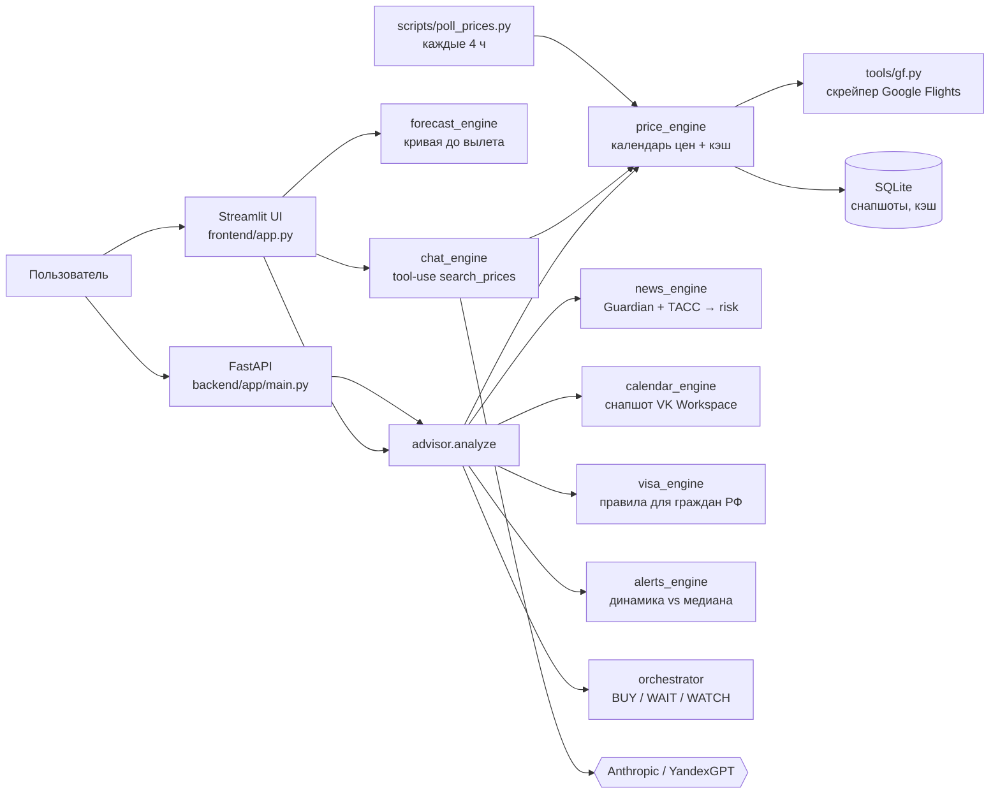

# ✈️ Flight Ticket Advisor

Платформа отвечает на один вопрос: **когда (от сегодняшнего дня до вылета) покупать билет, чтобы заплатить меньше**. Пользователь задаёт маршрут, даты и состав пассажиров и получает реальные цены Google Flights, вердикт **BUY / WAIT / WATCH** с объяснением каждого сигнала, прогноз цены до вылета, новости региона, визовые ограничения и пересечения с рабочим календарём. AI-помощник отвечает на вопросы и сам запускает поиск цен.

| | |
|---|---|
| 🌐 Веб-версия | https://flight-advisor-budget-finder.streamlit.app/ |
| 📽 Презентация (HTML, интерактивная) | https://raw.githack.com/maria-igntv/flight-advisor/main/docs/presentation.html — исходник [`docs/presentation.html`](docs/presentation.html) |
| 📓 Журнал разработки для ИИ-агентов | [`HANDOFF.md`](HANDOFF.md) |
| 🔌 API | `uvicorn backend.app.main:app` → http://localhost:8000/docs |

---

## Содержание

1. [Быстрый старт](#быстрый-старт)
2. [Как включить AI-помощника (подробно)](#как-включить-ai-помощника)
3. [Архитектура и почему именно она](#архитектура)
4. [7 ключевых решений и их обоснование](#7-ключевых-решений)
5. [LLM: Anthropic локально, YandexGPT в вебе — сравнение](#llm-anthropic-локально-yandexgpt-в-вебе)
6. [Метрики](#метрики)
7. [Как проект делался вайбкодингом](#как-проект-делался-вайбкодингом)
8. [Структура репозитория и API](#структура-репозитория)
9. [Ограничения](#ограничения)

---

## Быстрый старт

```bash
git clone https://github.com/maria-igntv/flight-advisor.git
cd flight-advisor
python3 -m venv .venv
.venv/bin/pip install -r requirements.txt        # Python 3.11–3.13
cp .streamlit/secrets.toml.example .streamlit/secrets.toml   # ключи LLM — см. ниже
.venv/bin/streamlit run frontend/app.py --server.headless true
```

UI откроется на http://localhost:8501. Поиск цен, вердикт, прогноз, новости, виза и календарь работают **без ключей**; ключи нужны только AI-помощнику.

---

## Как включить AI-помощника

Помощник умеет работать с двумя провайдерами и выбирает их так:

1. если задан `LLM_PROVIDER` (`anthropic` или `yandex`) и у этого провайдера есть ключи — он;
2. иначе Anthropic, если заданы `ANTHROPIC_BASE_URL` и `ANTHROPIC_AUTH_TOKEN`;
3. иначе YandexGPT, если заданы `YANDEX_GPT_API_KEY` и `YANDEX_GPT_FOLDER_ID`;
4. иначе чат показывает подсказку «LLM не настроен» (страница не падает).

Все ключи читает один модуль, [`backend/app/settings.py`](backend/app/settings.py): сначала переменные окружения, затем Secrets Streamlit. Поэтому **и локально, и в облаке ключи кладутся в одно и то же место — секреты Streamlit**.

### Шаг 1. Получить ключ YandexGPT (нужен для веб-версии)

1. Откройте https://console.yandex.cloud и войдите. Если платёжного аккаунта нет — создайте его (*Биллинг → Создать аккаунт*); новым аккаунтам даётся стартовый грант. Без активного платёжного аккаунта API вернёт `403`.
2. Выберите (или создайте) **каталог**. Его ID — строка вида `b1g…` — видна на странице каталога и в адресной строке. Это **`YANDEX_GPT_FOLDER_ID`**.
3. В этом каталоге: *Identity and Access Management → Сервисные аккаунты → Создать сервисный аккаунт*. Имя — например `flight-advisor`. Роль — **`ai.languageModels.user`**.
4. Откройте созданный аккаунт → *Создать новый ключ → Создать API-ключ*. Область действия — `yc.ai.languageModels.execute`. Скопируйте **секретную часть ключа** (начинается с `AQVN…`, показывается один раз). Это **`YANDEX_GPT_API_KEY`**.

### Шаг 2а. Веб-версия (Streamlit Cloud)

1. https://share.streamlit.io → приложение `flight-advisor-budget-finder` → меню **⋮ → Settings → Secrets** (или кнопка *Manage app* внизу справа на самом сайте → ⋮ → Settings).
2. Вставьте и сохраните:

   ```toml
   YANDEX_GPT_API_KEY = "AQVN...ваш ключ..."
   YANDEX_GPT_FOLDER_ID = "b1g...ваш каталог..."
   # YANDEX_GPT_MODEL = "yandexgpt/latest"   # необязательно; дешевле — "yandexgpt-lite/latest"
   ```
3. Приложение перезапустится само (около минуты). На странице «🤖 AI-помощник» появится подпись «Ответы генерирует YandexGPT».

Anthropic в облаке не настраивайте: корпоративный гейтвей `ai-proxy.vk.team` из облака недоступен (см. [сравнение](#llm-anthropic-локально-yandexgpt-в-вебе)).

### Шаг 2б. Локальный запуск

Создайте файл **`<корень репозитория>/.streamlit/secrets.toml`** — у автора это `/Users/maria.ignatova/flight-advisor/.streamlit/secrets.toml`. Проще всего скопировать шаблон:

```bash
cd ~/flight-advisor
cp .streamlit/secrets.toml.example .streamlit/secrets.toml
```

и заполнить **один** из вариантов (или оба):

```toml
# Вариант A — Anthropic (по умолчанию для локальной версии)
ANTHROPIC_BASE_URL = "https://ai-proxy.vk.team"     # корпоративный гейтвей; или https://api.anthropic.com
ANTHROPIC_AUTH_TOKEN = "...токен гейтвея или API-ключ console.anthropic.com..."
ANTHROPIC_MODEL = "claude-sonnet-5"

# Вариант B — YandexGPT (ключи из шага 1)
YANDEX_GPT_API_KEY = "AQVN..."
YANDEX_GPT_FOLDER_ID = "b1g..."

# Если заданы оба, а нужен YandexGPT:
# LLM_PROVIDER = "yandex"
```

Где взять токен Anthropic:
- **корпоративный гейтвей** — тот же токен, с которым у вас работает Claude Code (переменная `ANTHROPIC_AUTH_TOKEN` в вашем профиле shell, например `~/.zshrc`), либо выдаст администратор гейтвея;
- **публичный API** — https://console.anthropic.com → *API Keys → Create Key*, и тогда `ANTHROPIC_BASE_URL = "https://api.anthropic.com"`.

Перезапустите Streamlit (`Ctrl+C`, затем снова `streamlit run frontend/app.py`) — секреты читаются при старте. Файл `.streamlit/secrets.toml` в `.gitignore` и в репозиторий не попадёт. Переменные окружения (`export ANTHROPIC_AUTH_TOKEN=...`) тоже работают и имеют приоритет над файлом.

### Шаг 3. Проверка

```bash
.venv/bin/python -c "from backend.app.engines import chat_engine as c; print(c.provider(), c.configuration_error())"
# ожидается: anthropic None   (или: yandex None)
```

| Симптом | Причина и что сделать |
|---|---|
| «LLM не настроен…» | ключей нет там, где их ищет приложение: проверьте имена ключей и путь `.streamlit/secrets.toml` (папка `.streamlit` в **корне** репозитория, не в `frontend/`); перезапустите Streamlit |
| `YandexGPT ответил 401/403` | неверный ключ, у сервисного аккаунта нет роли `ai.languageModels.user`, ключ из другого каталога или не активен биллинг |
| `YandexGPT ответил 400` с `modelUri` | неверный `YANDEX_GPT_FOLDER_ID` или имя модели |
| `AI-помощник недоступен: Connection…` (Anthropic) | гейтвей недоступен из этой сети (VPN/корпоративная сеть) |

---

## Архитектура



**Выбрана архитектура «модульный монолит»**: один Python-процесс, движки — обычные модули с функцией-входом (`recommend`, `get_news`, `verdict`…), общий конвейер `advisor.analyze()`, хранилище SQLite, два тонких входа — Streamlit (для людей) и FastAPI (для интеграций). Фоновый поллер копит историю цен.

**Почему именно так:**

- **Объём и команда.** Один человек плюс ИИ-агент, сжатые сроки, около 4,7 тыс. строк кода. Микросервисы, брокеры и оркестраторы агентов добавили бы инфраструктуру, которую некому сопровождать.
- **Деплой.** Streamlit Cloud запускает ровно один Python-процесс без внешних баз. Модульный монолит со встроенным SQLite разворачивается там «как есть».
- **Объяснимость.** Каждый движок выдаёт сигнал с текстом, а оркестратор — прозрачную сумму. Это проще проверить и защитить, чем ответ LLM-агента.
- **Заменяемость.** Движки общаются словарями, поэтому скрейпер можно заменить на Travelpayouts, эвристику — на CatBoost, а SQLite — на Postgres, не трогая UI.

**Что рассматривалось и тестировалось:**

| Вариант | Статус | Почему нет / что вышло |
|---|---|---|
| LangGraph / CrewAI (мультиагентный граф) | отвергнут на этапе плана | ядро продукта — числа и правила, а не диалог; агентный фреймворк добавил бы недетерминизм и зависимость без выгоды |
| Flask (шаблон из учебного проекта botify) | рассмотрен | взят как образец структуры; FastAPI выбран за pydantic-валидацию и автодокументацию `/docs` |
| Отдельный фронтенд (React) + API | отвергнут | Streamlit даёт формы, графики и чат за десятки строк; для MVP и защиты это быстрее на порядок |
| Postgres + Redis | отложено | для MVP хватает SQLite (кэш читается за 19 мс); переход — при многопользовательской нагрузке |
| `fast_flights` как готовая библиотека | **протестирован, не работает** | её HTTP-клиент `primp` падал на DNS, парсер ломался; оставлена только сборка URL |
| GDELT 2.0 (новости) | **протестирован** | таймауты из рабочей сети и лимит 1 запрос/5 с → Guardian RSS + ТАСС |
| BBC RSS | **протестирован** | недоступен из сети (таймаут) |
| Google Calendar (OAuth, iCal) | **сделан и удалён** | на Streamlit Cloud OAuth-поток неудобен, а корпоративный календарь — VK Workspace → снапшот в репозитории |
| VK Workspace через MCP из веб-процесса | **невозможно** | MCP-сервер живёт только внутри Claude Code на машине автора |
| CatBoost-прогноз | отложен | нет истории цен (холодный старт) — сначала поллер копит данные |

---

## 7 ключевых решений

### 1. Ядро — правила и числа, LLM только как интерфейс
**Решение.** Вердикт BUY/WAIT/WATCH считает детерминированный оркестратор из сигналов «календарь цен», «динамика», «новости», «ваш календарь». LLM отвечает в чате и делает саммари новостей.
**Почему.** Вопрос «когда покупать» — про числа. LLM не знает сегодняшних цен и может их выдумать. Правила воспроизводимы: одинаковый вход даёт одинаковый вердикт. Их можно проверить юнит-тестами (7 сценариев оркестратора) и объяснить на защите: каждый сигнал показан текстом.
**Альтернатива.** «Спросить у GPT, когда покупать» — красиво, но непроверяемо.

### 2. Свой скрейпер Google Flights: httpx, затем curl, URL через `fast_flights`
**Решение.** URL с protobuf-параметром `tfs` собирается через `fast_flights.create_query`, страницу качает httpx, а при сбое или странице согласия — curl. Цены разбираются из встроенного JSON `AF_initDataCallback`.
**Почему.** Это единственный бесплатный источник без ключа с полной выдачей, включая состав пассажиров и туда-обратно. У Travelpayouts нужен токен и кэшированные цены, у Amadeus и Skyscanner — платный или партнёрский доступ. Готовая библиотека не работала (см. таблицу выше).
**Подтверждено замером** (`bench/run_scraper_bench.py`, 10 маршрутов): httpx p50 0,86 с против 9,6 с у curl, ошибок 0. Поэтому httpx основной, а curl — страховка. На Mac автора httpx периодически падал на SSL-рукопожатии, и именно поэтому fallback вообще появился.

### 3. SQLite-кэш снапшотов с изоляцией ключа + фоновый поллер
**Решение.** Каждый ответ Google сохраняется снапшотом с ключом «маршрут × дата × дата возвращения × состав пассажиров × валюта». Свежий снапшот (24 ч) отдаётся из кэша. Поллер раз в 4 часа опрашивает отслеживаемые маршруты.
**Почему.** Кэш даёт два эффекта. Скорость: 19 мс против ~1 с на дату, при диапазоне в 18 дат это секунды вместо минуты. Вежливость к источнику: меньше риск бана. А история снапшотов — единственный путь к будущему ML-прогнозу. Изоляцию ключа ввели после реальных багов: RUB-запрос получал USD-снапшот, а цена за двоих смешивалась с ценой за одного.

### 4. Прогноз до вылета — эвристическая кривая с «якорем» на реальной цене, а не CatBoost
**Решение.** Типовая кривая бронирования (плато за 3–8 месяцев до вылета, рост за месяц, крутой рост в последние 2 недели) нормируется на текущую реальную цену, а вокруг рисуется коридор неопределённости. При тревожных новостях коридор шире вверх.
**Почему.** Google не отдаёт историю цен, публичной бесплатной истории нет, а поллер копит данные только с 24.10.2026. Обучать CatBoost не на чем. Якорь на реальной цене делает прогноз применимым к любому маршруту. В UI он честно помечен как демо, а в БД не пишется.
**Путь развития.** Когда поллер накопит историю, CatBoost заменит одну функцию `forecast_curve`.

### 5. Модульный монолит + общий конвейер для UI и API
**Решение.** `engines/advisor.analyze()` — одна функция, которую вызывают и Streamlit, и FastAPI.
**Почему.** Раньше конвейер жил внутри `app.py`, и API отстал на несколько этапов: не умел туда-обратно, пассажиров и вердикт. Общий конвейер убирает этот класс ошибок. Подробнее о выборе монолита — в разделе [Архитектура](#архитектура).

### 6. Два LLM-провайдера: Anthropic локально, YandexGPT в вебе
**Решение.** Один и тот же агентный цикл с инструментом `search_prices` и два бэкенда, выбор автоматический по наличию ключей.
**Почему.** Решает доступность, а не вкус: из облака Streamlit корпоративный гейтвей недоступен физически. Подробности и методика сравнения — [следующий раздел](#llm-anthropic-локально-yandexgpt-в-вебе).

### 7. Внешние сервисы без ключей и OAuth: снапшот календаря, статичный визовый справочник, RSS
**Решение.** Календарь VK Workspace выгружается снапшотом `data/calendar_busy.json` в репозиторий. Визовые правила — JSON-справочник. Новости — публичные RSS.
**Почему.** Веб-версия должна работать без авторизации пользователя и без секретов, кроме LLM. MCP-сервер VK Workspace доступен только в Claude Code на машине автора, а Google OAuth на Streamlit Cloud ломал UX. Мы осознанно согласились с ценой: снапшот устаревает, и названия встреч видны в публичном репозитории (автор в курсе).

---

## LLM: Anthropic локально, YandexGPT в вебе

### Почему не один провайдер везде

| Критерий | Anthropic (корпоративный гейтвей `ai-proxy.vk.team`) | YandexGPT (Yandex Cloud Foundation Models) |
|---|---|---|
| Доступ из Streamlit Cloud (серверы в США/ЕС) | ❌ гейтвей доступен только из корпоративной сети | ✅ публичный API `llm.api.cloud.yandex.net` по API-ключу |
| Доступ с ноутбука автора | ✅ уже настроен, используется в Claude Code | ✅ при наличии ключа |
| Оплата | за счёт компании, ключ уже есть | рубли, платёжный аккаунт РФ, стартовый грант |
| Прямой публичный API как альтернатива | `api.anthropic.com` — оплата российской картой недоступна | — |
| Function calling (нужен для `search_prices`) | ✅ нативный tool-use | ✅ `tools` в API completion (у моделей без поддержки — автоматический откат на ответ без инструментов) |
| Сильная сторона для проекта | рассуждение, интерпретация дат («на Рождество», «майские»), длинный многошаговый tool-use | русский язык, данные остаются в РФ-облаке |

**Вывод.** Локально используется Anthropic, потому что он уже доступен автору бесплатно и, по нашей гипотезе, сильнее в многошаговом tool-use. В веб используется YandexGPT, потому что это единственный из двух провайдеров, до которого облако может достучаться и который можно оплатить. Код у провайдеров общий (`chat_engine`), и переключение — одна настройка `LLM_PROVIDER`.

### Методика сравнения на синтетике

Гипотезу «Anthropic сильнее» нужно подтверждать числами, поэтому в репозитории есть бенчмарк [`bench/run_llm_bench.py`](bench/run_llm_bench.py) на [44 синтетических кейсах](bench/cases.py). Он использует **боевой системный промпт и описание инструмента** из `chat_engine`. Google Flights не вызывается: результат поиска подставляется из кейса, поэтому прогон воспроизводим. «Сегодня» зафиксировано как 27.10.2026.

| Задача | Кейсов | Что проверяется | Метрика |
|---|---|---|---|
| Маршрутизация + аргументы | 20 | вопрос про цену → вызов `search_prices`; верные IATA (город или любой его аэропорт), даты (в т.ч. «через две недели», «на Рождество» — окном), дата возвращения («на неделю» = 6–8 дней), пассажиры, валюта | доля кейсов, где **все** поля верны; точность по полям |
| Без лишнего поиска | 10 | общий вопрос («нужна ли виза», «когда сакура») → ответ без вызова инструмента | precision / recall / F1 вызова инструмента |
| Опора на данные | 8 | по результату поиска назвать **реальную** минимальную цену и дату; ни одной выдуманной цены; пустой результат — честно сказать «цен нет» | доля корректных ответов |
| Саммари новостей | 6 | 2–4 предложения, без маркдауна, по-русски, тревожное событие отмечено | доля ответов, выполнивших все требования |
| Эксплуатация | все | латентность p50/p95, токены, ошибки API | — |

Запуск (нужны ключи обоих провайдеров в `.streamlit/secrets.toml`):

```bash
.venv/bin/python -m bench.run_llm_bench                                        # anthropic + yandexgpt/latest
.venv/bin/python -m bench.run_llm_bench --providers anthropic,yandex,yandex:yandexgpt-lite/latest --repeats 3
```

Результаты пишутся в `bench/results/llm_bench.{json,md}`. Презентация читает JSON сама и строит графики.

> **Статус: бенчмарк LLM ещё не прогнан.** На момент написания в рабочем окружении не было ключей ни одного провайдера, а выдумывать цифры мы не стали. После прогона таблица ниже заполняется из `bench/results/llm_bench.md`.

| Метрика | `anthropic:claude-sonnet-5` | `yandex:yandexgpt/latest` |
|---|---|---|
| Маршрутизация, F1 % | — | — |
| Аргументы: все поля верны, % | — | — |
| Опора на результат поиска, % | — | — |
| Саммари по требованиям, % | — | — |
| Латентность p50 / p95, с | — | — |

---

## Метрики

**Источник цен** (`bench/run_scraper_bench.py`, 27.10.2026, 10 маршрутов, российский IP):

| Метрика | httpx | curl |
|---|---|---|
| Получена страница с выдачей, % | 100 | 100 |
| Есть хотя бы одна цена, % | 90 | 90 |
| Латентность p50 / max, с | **0,86** / 1,37 | 9,62 / 14,2 |
| Ошибки | 0 | 0 |

- Чтение из кэша SQLite: **19 мс** (p50).
- Без цены остался один маршрут из десяти: MOW→BAX. Google находит рейсы «Уральских авиалиний», но перевозчик не отдаёт в него цены. UI сообщает об этом отдельно.

**Сквозные проверки** (Streamlit AppTest и FastAPI TestClient на живом Google):
- поиск MOW→IST туда-обратно на двоих: 59 866 ₽, вердикт BUY, 4 сигнала, 51 точка прогноза, предупреждения о визе и встречах, 0 исключений;
- чат без ключей показывает подсказку, а не падает;
- сценарий «в памяти устаревший модуль бэкенда» проходит без `AttributeError`.

**LLM** — см. [методику выше](#методика-сравнения-на-синтетике).

---

## Как проект делался вайбкодингом

**Роли.** Человек (автор) — продакт и приёмщик: формулирует задачу и критерии, смотрит результат в браузере, даёт фидбек. ИИ-агент (Claude Code, затем Cursor) — разработчик: планирует, пишет код, сам проверяет, документирует. Человек код почти не пишет.

**Цикл одного этапа:**

```
задача и критерий готовности
  → план агента (согласование)
  → код
  → самопроверка агентом: py_compile, юнит-сценарии, Streamlit AppTest, живой запрос к Google
  → демо пользователю (localhost / streamlit.app)
  → фидбек → фикс-раунд
  → запись в HANDOFF.md (что, почему, гочи) → коммит
```

**Правила, которые мы зафиксировали в начале и соблюдали:**
1. **Строго поэтапно**: после каждого этапа — стоп, показ, валидация, и только потом следующий этап.
2. **Честность в UI**: всё синтетическое (демо-история, прогноз) помечено; «нет цен» отличается от «источник не отдаёт цены».
3. **Объяснимость**: у каждого вердикта есть список сигналов с текстом.
4. **Память — в файле**: у агента нет памяти между сессиями, поэтому `HANDOFF.md` — его «бортовой журнал». Новая сессия начинает с него, и смена инструмента с Claude Code на Cursor прошла без потери контекста.
5. **Секреты не раскрываются**: агент проверяет только наличие ключей.

**Хронология** (подробности — в `HANDOFF.md` §4):

| Этап | Что сделано | Пример фидбека → решения |
|---|---|---|
| 0. Источник данных | проверка, что цены Google Flights достаются | `fast_flights` не работает → свой скрейпер |
| 1. MVP | движок цен, кэш SQLite, Streamlit, FastAPI | — |
| 1.5. UI | дропдауны аэропортов, детали рейса, AI-чат, поллер истории | «хочу видеть номер рейса» → разбор сегментов из payload |
| 2. Туда-обратно и новости | round-trip, Guardian + ТАСС, risk-словарь | «strike» ловил военные удары → убран из словаря |
| 3. Вердикт | alerts_engine + orchestrator BUY/WAIT/WATCH | принцип «объяснимый AI» |
| 4. Календарь | занятость VK Workspace как 4-й сигнал | MCP недоступен веб-процессу → снапшот |
| Раунды 1–3 | пассажиры, опциональные даты, BAX без цен, tool-use в чате | модель считала текущим 2025 год → дата в промпте |
| Раунды 4–5 | годовая демо-история, прогноз «сегодня → вылет» | «главное — когда покупать» → прогноз вместо ретроспективы |
| Раунды 6–8 | бегущая строка новостей, тёмная тема, валютный fallback, визы | MOW→LON без цен в RUB → поиск в USD и курс ЦБ |
| Раунд 9 | YandexGPT для веб-версии | гейтвей недоступен из облака |
| Раунд 10 | фикс облака, FastAPI на общем конвейере, бенчмарки, README | `AttributeError` в облаке → перезагрузка модулей бэкенда |

**Цифры процесса:** 4 основных этапа и 10 фикс-раундов за 4 дня (24–27.10.2026), около 4,7 тыс. строк кода, два ИИ-инструмента: Claude Code (этапы 0–8) и Cursor (облачный агент — раунд 9, локальный — раунд 10).

**Чему научились.** Самые дорогие ошибки агента — не в коде, а в допущениях об окружении. Примеры: «облако видит тот же гейтвей», «Streamlit перечитает все модули», «Google отдаёт облаку ту же страницу». Каждое такое допущение теперь записано в HANDOFF как «гоча».

---

## Структура репозитория

```
frontend/app.py              Streamlit UI: поиск, календарь, AI-помощник
backend/app/main.py          FastAPI
backend/app/settings.py      секреты: env → .streamlit/secrets.toml / Secrets
backend/app/engines/
  advisor.py                 общий конвейер analyze() для UI и API
  price_engine.py            календарь цен, кэш, валютный fallback
  alerts_engine.py           динамика цены vs медиана истории
  news_engine.py             Guardian + ТАСС → дайджест и risk
  calendar_engine.py         занятость из снапшота VK Workspace
  visa_engine.py             правила въезда для граждан РФ
  orchestrator.py            вердикт BUY / WAIT / WATCH
  forecast_engine.py         прогноз цены до вылета
  demo_history.py            синтетическая история (помечена)
  chat_engine.py             AI-помощник, tool-use search_prices
  yandex_gpt.py              клиент YandexGPT
backend/app/tools/           скрейпер gf.py, курсы fx.py, аэропорты, HTTP
scripts/poll_prices.py       поллер истории цен
bench/                       бенчмарки LLM и источника цен + результаты
docs/presentation.html       интерактивная презентация
HANDOFF.md                   журнал разработки для ИИ-агентов
```

**API** (`uvicorn backend.app.main:app`, документация на `/docs`):

| Метод | Путь | Что делает |
|---|---|---|
| POST | `/api/recommend` | полный отчёт: календарь цен, вердикт с сигналами, прогноз, виза, новости, занятость |
| GET | `/api/calendar` | только календарь min-цен |
| GET | `/api/news/{dest}` | новости региона и risk |
| GET | `/api/visa/{dest}?dep=&ret=` | визовый режим и проверка срока |
| GET | `/api/busy?start=&end=` | занятые дни из календаря |
| POST | `/api/chat` | AI-помощник |
| GET | `/api/diag` | что Google вернул при последнем запросе, активный LLM |

---

## Ограничения

- Google Flights — неофициальный источник. При смене разметки парсер сломается, и `run_scraper_bench` это покажет.
- На Streamlit Cloud Google может отдавать капчу; тогда нужен прокси `GF_PROXY` в Secrets. Под предупреждением «нет цен» выводится строка диагностики с причиной.
- Прогноз — эвристика, не ML: до накопления истории цен CatBoost невозможен.
- Визовый справочник статичен: в UI есть напоминание перепроверить правила на сайте МИД.
